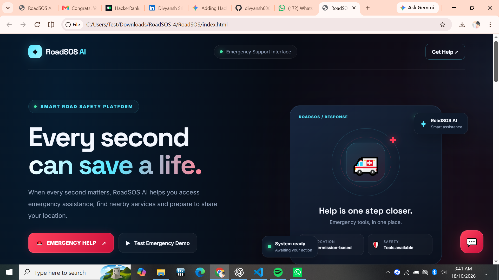
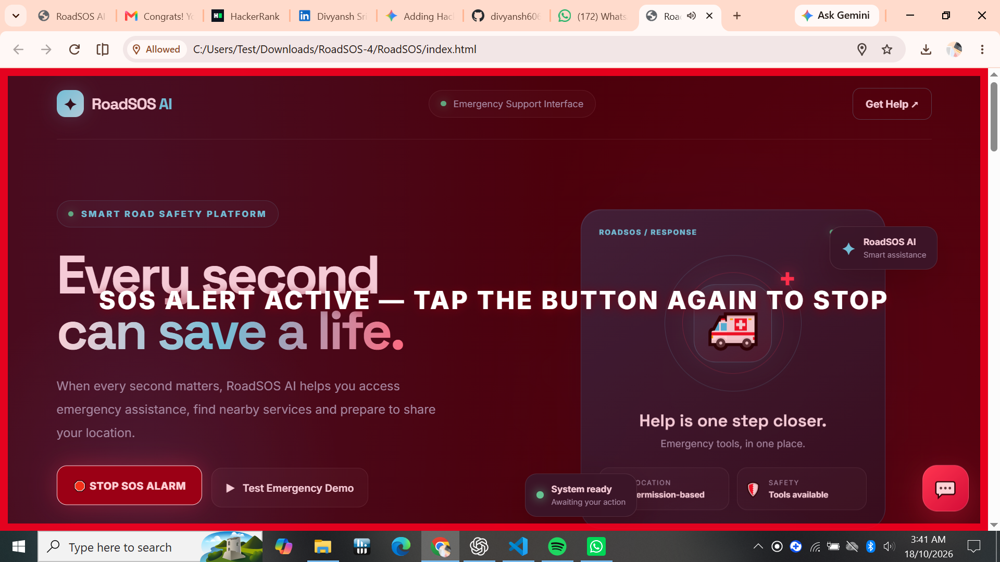
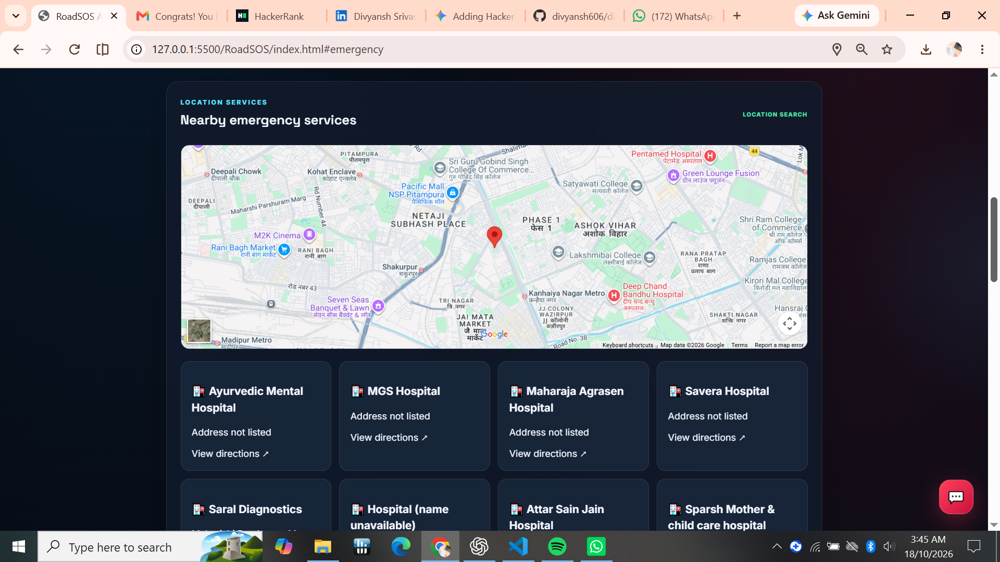
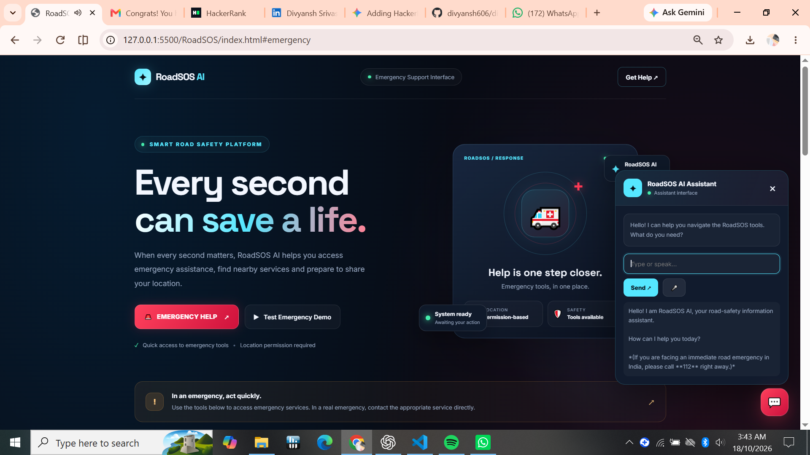
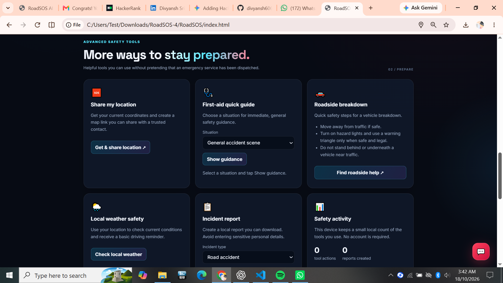
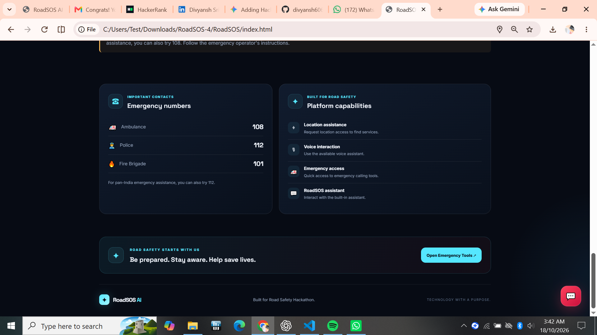

# RoadSOS AI — Road safety support prototype

Team: The Rockerz  
Team leader: Divyansh Srivastava  
College: Hi-Tech Institute of Engineering & Technology, Ghaziabad

## Run the website
Open `index.html` through VS Code Live Server or another local HTTP server. GPS features may not work when opened directly as a file.

## Features
- Browser-based location and map display
- Nearby hospital search via OpenStreetMap
- Emergency call links and a user-confirmed WhatsApp alert flow
- First-aid quick guide and roadside breakdown tips
- Location sharing and local weather safety
- Downloadable local incident report
- Local-only activity dashboard
- Voice assistant and basic chatbot, with optional secure AI backend in `server/`

## Important
This is a support prototype, not an emergency dispatch service or a medical professional. In an immediate emergency in India, call **112** and follow the operator's instructions. The site does not automatically call an ambulance or notify family.

## Screenshots

### Homepage

### Emergency Alert

### Nearby Hospitals

### AI Chatbot

### Safety Features

### Services Map

